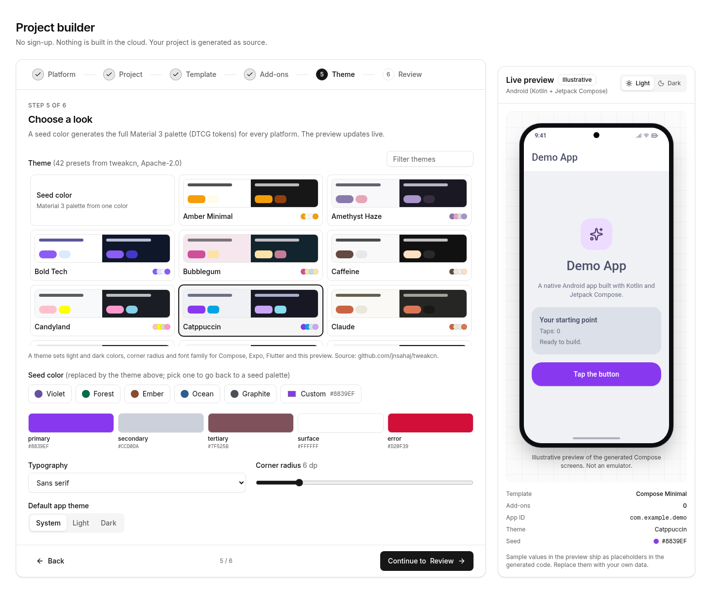
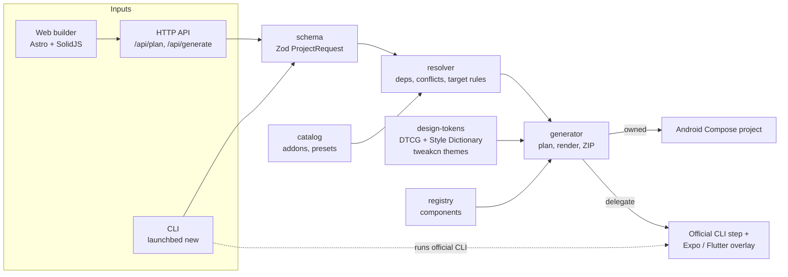

# Launchbed

**Create mobile app starters for several stacks from one configuration.** Pick a target, a
template, addons and a theme in the web builder, the HTTP API or the CLI, and get a project
that already has a design system, screens, tests, pinned tools (`mise`) and a command catalog
(`just`).



Launchbed handles each stack in one of two ways:

- **Android (Kotlin + Jetpack Compose) is owned.** Launchbed writes the whole Gradle project
  from its own template. The output is deterministic and checked against the plan.
- **Expo and Flutter are delegated.** Launchbed runs the official CLI (`create-expo-app`,
  `flutter create`) and then writes an overlay on top: tokens, screens, components, `mise.toml`,
  `justfile`, CI and docs.
- **Tauri 2 + SolidJS is planned.** It is in the catalog but cannot be generated yet.

Launchbed is a starter creator, not a runtime framework. Generated projects have no dependency
on Launchbed.

## Features

- **One request, three stacks.** The same `ProjectRequest` (name, app id, preset, addons,
  theme) drives the web builder, `POST /api/generate` and `launchbed new`.
- **Design tokens.** A W3C DTCG token document is compiled with Style Dictionary into Compose
  Kotlin, TypeScript, Dart and CSS, from a Material 3 seed color or one of 42 imported themes.
- **Screen pack.** Onboarding, sign-in (in-memory fake auth), dashboard, notes, profile and
  settings come with bottom tabs, dark mode and local persistence, on Compose, Expo and Flutter.
- **Addons** are declarative JSON manifests with dependencies, conflicts, SDK rules and
  per-target support. Examples are key-value storage, an HTTP client, formatting, GitHub Actions,
  scrcpy and Room.
- **Component registry** in the style of shadcn: `launchbed add button` copies a component's
  source into your project.
- **Generated developer experience:** `mise install`, then `just doctor`, `just test`,
  `just run`, plus `adb` and scrcpy recipes (mirror, record, screenshot) on Android.
- **Safe by design.** The server never runs user input or fetches remote templates. ZIPs are
  deterministic and size-limited. Errors are typed JSON.

## Support matrix

<!-- matrix:start (generated by scripts/readme-matrix.ts; do not edit by hand) -->

**Targets**

| Target | Strategy | Status |
|---|---|---|
| Android (Kotlin + Jetpack Compose) | owned (Launchbed writes the whole project) | stable |
| Expo (React Native) | delegate (`create-expo-app` + Launchbed overlay) | beta |
| Flutter | delegate (`flutter` + Launchbed overlay) | beta |
| Tauri 2 + SolidJS | delegate (`create-tauri-app` + Launchbed overlay) | planned |

**Presets**

| Preset | Compose | Expo | Flutter | Tauri + Solid | Status |
|---|---|---|---|---|---|
| `app-starter` | ✓ | ✓ | ✓ | — | beta |
| `catalog-ui` | ✓ | — | — | — | beta |
| `client-server` | ✓ | — | — | — | planned |
| `compose-minimal` | ✓ | — | — | — | stable |
| `compose-starter` | ✓ | — | — | — | beta |
| `inventory-offline` | ✓ | — | — | — | planned |
| `local-notes` | ✓ | — | — | — | beta |
| `media-player` | ✓ | — | — | — | planned |
| `offline-reader` | ✓ | — | — | — | planned |

**Addons**

| Addon | Compose | Expo | Flutter | Tauri + Solid | Status |
|---|---|---|---|---|---|
| `network/http-client` | ✓ | ✓ | ✓ | — | beta |
| `storage/key-value` | ✓ | ✓ | ✓ | — | beta |
| `storage/room` | ✓ | — | — | — | beta |
| `tooling/format` | ✓ | ✓ | ✓ | — | beta |
| `tooling/github-actions` | ✓ | ✓ | ✓ | — | beta |
| `tooling/scrcpy` | ✓ | ✓ | ✓ | — | beta |
| `ui/auth` | ✓ | ✓ | ✓ | — | beta |
| `ui/catalog` | ✓ | — | — | — | beta |
| `ui/dashboard` | ✓ | ✓ | ✓ | — | beta |
| `ui/foundation` | ✓ | — | — | — | beta |
| `ui/navigation` | ✓ | ✓ | ✓ | — | beta |
| `ui/notes` | ✓ | ✓ | ✓ | — | beta |
| `ui/onboarding` | ✓ | ✓ | ✓ | — | beta |
| `ui/profile` | ✓ | ✓ | ✓ | — | beta |
| `ui/settings` | ✓ | ✓ | ✓ | — | beta |

Planned, not generatable yet: `foundation/core`, `native/jni-bridge`, `native/rust-ffi`, `native/zig-ffi`, `storage/libsql-android`, `storage/sqld-remote`, `storage/sqlite-direct`, `storage/turso`, `tooling/android-cli`, `tooling/docker-compose`.

**Registry components** (`launchbed add <name>`)

| Component | Compose | Expo | Flutter | Tauri + Solid |
|---|---|---|---|---|
| `app-bar` | ✓ | ✓ | ✓ | — |
| `avatar` | ✓ | ✓ | ✓ | — |
| `badge` | ✓ | ✓ | ✓ | — |
| `bottom-sheet` | ✓ | ✓ | ✓ | — |
| `button` | ✓ | ✓ | ✓ | — |
| `card` | ✓ | ✓ | ✓ | — |
| `dialog` | ✓ | ✓ | ✓ | — |
| `list-item` | ✓ | ✓ | ✓ | — |
| `snackbar` | ✓ | ✓ | ✓ | — |
| `switch` | ✓ | ✓ | ✓ | — |
| `text-field` | ✓ | ✓ | ✓ | — |

Themes: 42 presets imported from tweakcn (Apache-2.0), usable on every target with `--theme <id>`.

<!-- matrix:end -->

"Beta" means the addon generates, builds and passes its unit tests, but has not been
verified on a device yet. `tests/readme-matrix.test.ts` keeps this table in sync with the
catalogs.

## Quickstart

Requirements: [mise](https://mise.jdx.dev) (it installs Bun, Node, JDK 21 and just from
`mise.toml`), or those tools installed yourself.

```bash
git clone https://github.com/jhovadev/launchbed.git
cd launchbed
mise install
bun install
just dev                     # web builder on http://localhost:4321
```

Generate from the CLI:

```bash
# Android (owned): writes demo-app/ and demo-app.zip
bun packages/cli/src/index.ts new --yes --name "Demo App" --app-id com.example.demo \
  --preset app-starter --theme catppuccin --out demo-app
cd demo-app && mise install && just doctor && just build && just test

# Expo (runs create-expo-app, then writes the overlay)
bun packages/cli/src/index.ts new --yes --name "Demo Expo" --app-id com.example.demoexpo \
  --target expo --preset app-starter --addon ui/notes --out demo-expo
cd demo-expo && just test && just dev

# Flutter (runs flutter create, then writes the overlay)
bun packages/cli/src/index.ts new --yes --name "Demo Flutter" --app-id com.example.demoflutter \
  --target flutter --preset app-starter --out demo-flutter
cd demo-flutter && just test
```

Android builds need JDK 21 and an Android SDK. Run `just sdk-setup` inside the generated
project, or set `ANDROID_HOME`. Android Studio is optional.

## CLI reference

Run it with `bun packages/cli/src/index.ts <command>`. The package's binary name is `launchbed`.

| Command | What it does |
|---|---|
| `new [dir] [--name] [--app-id] [--target] [--preset] [--theme] [--addon]... [--out] [--yes] [--force]` | Writes a project directory plus a sibling ZIP. Without `--yes`, it prompts on a TTY. |
| `catalog [--json]` | Lists targets, addons (with status) and themes. |
| `components [--json]` | Lists registry components and their support per target. |
| `add <component> [--out <dir>] [--force]` | Copies a registry component into an existing Launchbed project (found through `launchbed.json`). |
| `doctor [--target <id>] [--json]` | Checks the prerequisites for a target (for example JDK and Android SDK, Node and npx, or Flutter, plus just and mise). |
| `validate --config <file\|-> [--json]` | Validates a `ProjectRequest` JSON. |
| `plan --config <file\|-> [--json]` | Prints the generation plan: files, operations, official CLI steps. |
| `generate --config <file\|-> [--out <file.zip>] [--force]` | Writes the ZIP only. |

`--addon` can be repeated. `new` and `generate` refuse to overwrite existing output unless you
pass `--force`.

## HTTP API

```bash
curl -s http://localhost:4321/api/catalog
curl -s -X POST http://localhost:4321/api/plan \
  -H 'content-type: application/json' --data @examples/basic.json
curl -s -X POST http://localhost:4321/api/generate \
  -H 'content-type: application/json' --data @examples/basic.json -o demo-app.zip
```

For `"target": "expo"` or `"flutter"`, `/api/generate` returns an overlay-only ZIP. Its
`LAUNCHBED_OVERLAY.md` and the `x-delegate-command` header give the official command to run
first, followed by `unzip -o` inside the new project. Errors are typed: `INVALID_REQUEST`,
`RESOLUTION_ERROR`, `LIMIT_EXCEEDED`, `SECURITY_ERROR`, `TEMPLATE_ERROR`, `ZIP_ERROR`.

## Design tokens and themes

`ThemeConfig` (a seed color, scheme variant, overrides for the 29 Material roles, font, corner
radius, spacing and component tokens) resolves to light and dark tokens with Material Color
Utilities. Those tokens are written as a DTCG document (`design-tokens.json`), and Style
Dictionary 5.8.0 compiles them at generate time into:

| Target | Output |
|---|---|
| Compose | `ui/theme/GeneratedColors.kt`, `GeneratedTokens.kt`, `tokens/tokens.css` |
| Expo | `tokens/tokens.ts`, `tokens/tokens.css` |
| Flutter | `lib/tokens/tokens.dart`, `tokens/tokens.css` |

`--theme <id>` (or `"themeId"` in the API, or the Theme step in the web builder) applies one of
**42 presets imported from [tweakcn](https://github.com/jnsahaj/tweakcn) (Apache-2.0)**. The
presets are stored as committed JSON in `packages/design-tokens/themes/` and regenerated by
`scripts/import-tweakcn-themes.ts`. See [docs/THIRD_PARTY.md](docs/THIRD_PARTY.md) for
attribution and the changes made. More details: [docs/design-system.md](docs/design-system.md).

## Component registry

`registry/components/<name>/` holds one manifest plus a source file per target (Compose
`Launchbed*.kt`, Expo `components/ui/*.tsx`, Flutter `lib/ui/components/*.dart`). Components
take their colors from the generated tokens and theme, so they follow light and dark mode.

```bash
bun packages/cli/src/index.ts components
bun packages/cli/src/index.ts add dialog --out demo-expo
```

## Generated project tooling

Every generated project has the same split:

- **`mise.toml`** pins tools: JDK on Android, Node and Bun on Expo, Flutter on Flutter, plus just
  and scrcpy, and addon tools such as ktlint. It holds no secrets.
- **`justfile`** is the command catalog:
  - Android: `doctor`, `sdk-setup`, `build`, `test`, `lint`, `run`, `logs`, `devices`,
    `mirror`, `record`, `screenshot`, `deeplink`, `clear-data`.
  - Expo: `dev`, `android`, `ios`, `lint`, `test` (a typecheck limited to Launchbed files,
    plus unit tests), `typecheck-all`, `prebuild`, `eas-build`, `devices`, `mirror`, `record`.
  - Flutter: `dev`, `android`, `ios`, `lint` (`flutter analyze`), `test`, `devices`, `mirror`,
    `record`.
  - Addons can contribute recipes and tools. Conflicting recipe bodies or tool versions fail
    before any file is written.
- **`AGENTS.md`** and `docs/` explain the project to people and coding agents.

## Architecture



| Path | Role |
|---|---|
| `apps/web/` | Astro + SolidJS builder and API routes |
| `packages/schema/` | Zod contracts, limits, typed errors, CLI command formatting |
| `packages/catalog/` | Validated addon and preset registry (`addons/*.json`, `presets/*.json`) |
| `packages/resolver/` | Dependency, conflict, SDK and per-target rules |
| `packages/generator/` | Planner, renderer, overlays, screen packs, deterministic ZIP |
| `packages/design-tokens/` | Theme resolution, Style Dictionary, tweakcn presets |
| `packages/preview/` | Web preview of the generated screens |
| `packages/cli/` | The `launchbed` CLI |
| `templates/`, `registry/` | Android template, overlay fragments, components |

More: [docs/architecture.md](docs/architecture.md),
[docs/addon-spec.md](docs/addon-spec.md),
[docs/roadmap-multi-target.md](docs/roadmap-multi-target.md).

## Contributing

```bash
just check                   # typecheck, astro check, bun test, template drift, web build
LAUNCHBED_E2E_EXPO=1 bun test tests/expo-e2e.test.ts         # runs create-expo-app (network)
LAUNCHBED_E2E_FLUTTER=1 bun test tests/flutter-e2e.test.ts   # needs Flutter 3.50.0 (mise)
just android-smoke           # real Gradle build + unit tests (JDK 21 + Android SDK)
```

After you edit `templates/` or `registry/`, run `just templates-embed`. After you change addons,
presets or components, run `bun scripts/readme-matrix.ts --write`. Read [AGENTS.md](AGENTS.md)
and [CONTRIBUTING.md](CONTRIBUTING.md) before opening a pull request. Report security issues as
described in [SECURITY.md](SECURITY.md).

### Android runtime and release gates

- `just runtime-parser-test` and `just integrity-check` need no Android tools.
- `just android-runtime-compile` compiles every implemented preset and its test APKs.
- `ANDROID_SERIAL=<serial> just android-test` runs instrumented tests on one device you
  choose.
- `just release-check` reports BLOCKED (exit 78) until device and benchmark evidence exists.
- To create and start an emulator without Android Studio, see
  [F1.6F](docs/phases/F1.6F-cli-avd-provisioning.md): `just emulator-images`,
  `just emulator-create`, `just emulator-start`.
- Also see [runtime testing](docs/runtime-testing.md) and [integrity](docs/integrity.md).

## Roadmap

- **Done:** owned Compose, delegated Expo and Flutter (beta), the screen pack on all three
  (onboarding, auth, dashboard, notes, profile, settings), persistence, dark mode, cross-target
  addons, a registry of 11 components, and 42 themes.
- **Next:** Tauri 2 + SolidJS, device verification to move addons from beta to stable,
  templates that are ktlint-clean, and a provider-neutral auth interface.
- **Later:** native FFI (UniFFI, `flutter_rust_bridge`), libSQL/Turso storage, Tauri + Svelte.

Details: [docs/roadmap-multi-target.md](docs/roadmap-multi-target.md).

## License

MIT, see [LICENSE](LICENSE). The theme presets come from tweakcn under Apache-2.0 (see
[docs/THIRD_PARTY.md](docs/THIRD_PARTY.md)). Licenses of the dependencies of generated projects
are listed in [docs/compatibility.md](docs/compatibility.md).
